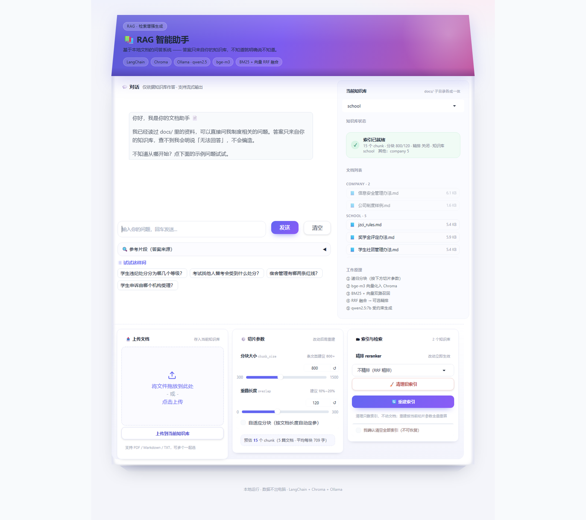

# 本地知识库 RAG 问答系统

> 一个完全跑在自己电脑上的中文检索增强问答系统。把制度文档丢进 `docs/`，就能用自然语言提问，
> 每个回答都附带可追溯的原文片段。**不联网、不需要 API Key、数据不出本机。**

基于 LangChain + Chroma + Ollama 实现，自建 BM25 与向量的混合检索，带一个 Gradio Web 界面。



---

## 项目简介

企业内部制度、学校规章这类文档通常有三个特点：**篇幅长、条款密、问法口语化**。
直接塞给大模型行不通（上下文装不下、还会编），纯关键词搜索又答不了「考试作弊怎么处理」这种问题。

这个项目把整条链路搭了出来：

```
文档 → 递归分块 → bge-m3 向量化 → Chroma 持久化
                                        ↓
用户提问 → BM25 + 向量双路召回 → RRF 融合 → 可选精排 → Top 4 片段
                                        ↓
                          qwen2.5:7b 受约束生成 → 流式答案 + 出处
```

- **多知识库隔离**：`docs/` 下每个子目录就是一个独立知识库（如 `school/`、`company/`），
  各建一个 Chroma collection。问学校的问题不会召回公司条文。
- **混合检索**：向量管语义、BM25 管专有名词与编号。中文 BM25 需要先分词——
  这里用零依赖的汉字二元组分词，避免关键词通道变成噪声。
- **可溯源**：答案下方列出每个参考片段的来源文件、匹配得分，以及它在 BM25 / 向量 / 精排三路的排名。
- **可评测**：召回与幻觉两套指标分开算，附 26 条召回题 + 4 条幻觉题。

### 实测效果

| 指标 | 含义 | 结果 |
|---|---|---|
| Recall@4 | 正确片段出现在前 4 条的比例 | **25/26 = 96.2%** |
| Recall@1 | 最相关片段排在第一的比例 | **24/26 = 84.6%** |
| MRR@4 | 首位命中排名的平均倒数 | **0.885** |
| 拒答率 | 知识库无答案时正确说「不知道」 | **4/4 = 100%** |

索引规模：`school` 15 chunk + `company` 5 chunk。
按库拆开看，学校 17/18、MRR 0.917；公司 8/8、MRR 0.812。

> 这组数字是在「Top-4 小于 chunk 总数」的前提下测的。早前索引只有 4 块时，
> Top-4 等于全量返回，Recall 必然是 100%，那个指标是假的——细节记在
> [`开发笔记.md`](开发笔记.md)。

## 功能特性

**检索层**
- BM25（权重 0.4）+ 向量（0.6）双路召回，候选各 12 条，RRF 融合（k=20）
- 手写 `HybridRetriever`，不依赖 `EnsembleRetriever`，融合公式和权重都可调
- 四档精排：关闭 / 向量重排（bge-m3 余弦）/ LLM 精排 / bge-reranker 交叉编码器
- 融合去重键用 `chunk_id = sha1(来源 + 块序号 + 内容)`，不用内容前缀（否则开头相同的块会被错误合并）

**文档层**
- 支持 PDF / Markdown / TXT，界面里可多选上传到当前知识库
- 切片参数可视化调整：块大小 300~1500、重叠 0~300，实时预估 chunk 数
- 自适应分块：按单篇长度自动定参（<2 千字 400/60，2~6 千字 700/110，>6 千字 1000/160）
- Chroma 删除集合后残留的 HNSW 目录会被自动清理，不会越重建越臃肿

**界面层**
- 流式输出，首帧 0.1 秒内回显问题（不用等检索和首 token）
- 「参考片段」面板逐条标出 BM25 名次、向量名次、精排名次
- 立方体三面布局，窄屏自动收起透视并纵向堆叠（见[窄屏截图](assets/screenshot-mobile.png)）
- 清理索引与重建索引是两个独立按键，可先调参数再建库

**工程层**
- 分块 / 检索 / 精排 / 索引维护收敛在 `rag_core.py`，四个入口共用同一份配置，参数不会错位
- 索引签名（sqlite mtime + size + chunk 数）检测跨进程变更，UI 开着时命令行重建也能立刻生效
- Windows 控制台编码（cp936）下输出 emoji 不再崩

## 技术栈

| 层 | 选型 | 说明 |
|---|---|---|
| LLM 框架 | LangChain | 加载、切分、检索、生成 |
| 本地模型 | Ollama + `qwen2.5:7b` | 生成最终答案 |
| Embedding | Ollama + `bge-m3` | 中英文向量化，也用于向量重排 |
| 向量库 | Chroma | 本地持久化，按知识库分 collection |
| 关键词检索 | rank_bm25（BM25Okapi） | 补专有名词、编号、精确词召回 |
| 融合 | 手写 RRF | `score = Σ w/(k + rank)`，k 可配 |
| 中文分词 | 自写汉字二元组 | 零依赖，替代 jieba |
| Web 界面 | Gradio 6 | 流式问答、参考片段、参数面板 |

## 快速开始

### 1. 环境要求

- Python **3.10+**（开发环境 3.13）
- [Ollama](https://ollama.com/download) 已安装并运行
- 内存建议 16 GB 以上（`qwen2.5:7b` 量化后约 4.7 GB）

### 2. 安装

```bash
git clone <your-repo-url>
cd <仓库目录名>

python -m venv .venv
# Windows
.venv\Scripts\activate
# macOS / Linux
source .venv/bin/activate

pip install -r requirements.txt
```

> 想要 `bge-reranker` 交叉编码器精排，再额外 `pip install sentence-transformers`
> （会连带拉 torch，约 2 GB）。不装也能跑，精排选「关闭」或「向量重排」即可。

### 3. 启动模型服务

```bash
ollama serve            # 常驻；装好 Ollama 后通常已自动在跑

ollama pull qwen2.5:7b  # 生成模型，约 4.7 GB
ollama pull bge-m3      # 向量模型，约 1.2 GB
```

### 4. 准备文档

```
docs/
├── school/      ← 一个子目录 = 一个知识库
│   ├── 奖学金评定办法.md
│   └── ...
└── company/
    └── ...
```

仓库自带两套样例文档（学校 5 篇、公司 2 篇），可以直接跑通；换成自己的文档也一样，
新建一个子目录放进去即可。

### 5. 建索引

```bash
python check_env.py                 # 自检：依赖 / Ollama / 模型 / 索引
python 01_build_index.py            # 建全部知识库
python 01_build_index.py --corpus school          # 只建一个
python 01_build_index.py --chunk-size 400 --overlap 60   # 临时指定切片参数
```

### 6. 开始使用

**Web 界面（推荐）**

```bash
python 04_app.py
# 浏览器打开 http://127.0.0.1:7860
```

界面里可以做这些事：

| 位置 | 能做什么 |
|---|---|
| 右上「当前知识库」 | 切换学校 / 公司，问答只检索选中的那个 |
| 左侧对话区 | 输入问题回车，流式出答案；展开「参考片段」看出处 |
| 上传文档 | PDF / MD / TXT 多选，传完点重建 |
| 切片参数 | 拖滑块或勾「自适应分块」，右侧实时显示预计 chunk 数 |
| 精排 reranker | 切换后立即生效，不用重建索引 |
| 清理旧索引 | 只删集合与残留目录，不动 `docs/` 里的文件（不可恢复，需勾选确认） |
| 重建索引 | 按当前切片参数全量重算 |

**命令行问答**

```bash
python 02_query.py --corpus school
# 输入问题回车；/config 看当前参数，/quit 退出
```

**跑评测**

```bash
python 03_eval.py                 # 召回 + 幻觉全跑
python 03_eval.py --recall-only   # 只跑召回（快，不调 LLM）
python 03_eval.py --halluc-only   # 只测拒答
```

## 目录结构

```
rag-kb/                         # 仓库根目录
├── docs/                       # 只放知识库文档，子目录 = 知识库
│   ├── school/                 # 知识库 1：学校制度（5 篇）
│   └── company/                # 知识库 2：公司制度（2 篇）
├── assets/                     # 界面截图
├── 开发笔记.md                  # 踩坑记录、调参过程、设计取舍
├── rag_core.py                 # ★ 共享内核：分块 / 检索 / 精排 / 索引维护
├── 01_build_index.py           # 加载 → 分块 → 向量化 → 入库
├── 02_query.py                 # 命令行问答
├── 03_eval.py                  # 召回 / 幻觉双指标评测
├── 04_app.py                   # Gradio Web 界面
├── check_env.py                # 环境自检
├── rag_ui_config.json          # 切片与检索参数（四个入口共用的唯一来源）
├── requirements.txt
└── vectorstore/                # Chroma 持久化（首次建库后生成，不入库）
```

## 配置说明

参数都存在 `rag_ui_config.json`，界面改动会写回这里，命令行也读它。

| 字段 | 默认 | 说明 |
|---|---|---|
| `chunk_size` | 800 | 分块大小。条文类建议 800+，太小会把一条规定切成两半 |
| `chunk_overlap` | 120 | 相邻块重叠，建议为块大小的 10%~20% |
| `adaptive` | false | 按单篇文档长度自动定参 |
| `top_k` | 4 | 最终喂给模型的片段数 |
| `candidate_k` | 12 | 每路召回的候选数 |
| `bm25_weight` | 0.4 | BM25 在 RRF 中的权重 |
| `vector_weight` | 0.6 | 向量在 RRF 中的权重 |
| `rerank` | off | `off` / `embed` / `llm` / `cross` |
| `rrf_k` | 20 | RRF 平滑常数。语料只有几十块时不要用 60，会把排名抹平 |

## 常见问题

**Q：`ConnectionError: Failed to connect to Ollama`**
Ollama 服务没起来。终端执行 `ollama serve`，或确认任务栏里 Ollama 在运行。

**Q：回答「文档中未提及相关内容」，但我明明放了文档**
按顺序排查：① 索引是否建过（`python check_env.py` 看 chunk 数）；
② 当前选的知识库对不对（文档在 `docs/company/` 却停在 `school`）；
③ 切片是否过小导致一条规定被切断；④ 换个问法再试，口语化问题更容易命中。

**Q：改了 `docs/` 里的文档，界面还是旧答案**
改完文档要重建索引。如果是在命令行重建、界面一直开着，新版会自动检测到索引变更并重载，无需重启。

**Q：重建几次后 `vectorstore/` 里堆了一堆 uuid 目录**
Chroma 的 `delete_collection()` 只删元数据，不删 HNSW 段目录。程序启动时会自动清理孤儿目录；
被 Windows 文件锁住删不掉的，下次启动再清。

**Q：中文 BM25 为什么不用 jieba**
`langchain` 默认按 `\W+` 切词，一整段中文会变成一个 token，等于要求整段完全匹配。
汉字二元组分词零依赖、对制度条文足够用，先跑通再谈优化。

**Q：LLM 精排效果很差**
小模型做 listwise 排序会照抄示例、给无关顺序（实测 qwen2.5:7b 把最相关片段排到最后，还多花 10~16 秒）。
默认关闭，需要更好排序请用 `bge-reranker` 交叉编码器。

## 开发笔记

踩坑记录（28 条）、调参过程、指标可信性的三次修正，以及「为什么这么设计」的取舍，
都写在 [`开发笔记.md`](开发笔记.md)。适合想复现或想知道哪里容易翻车的人读。

## License

[MIT](LICENSE)
